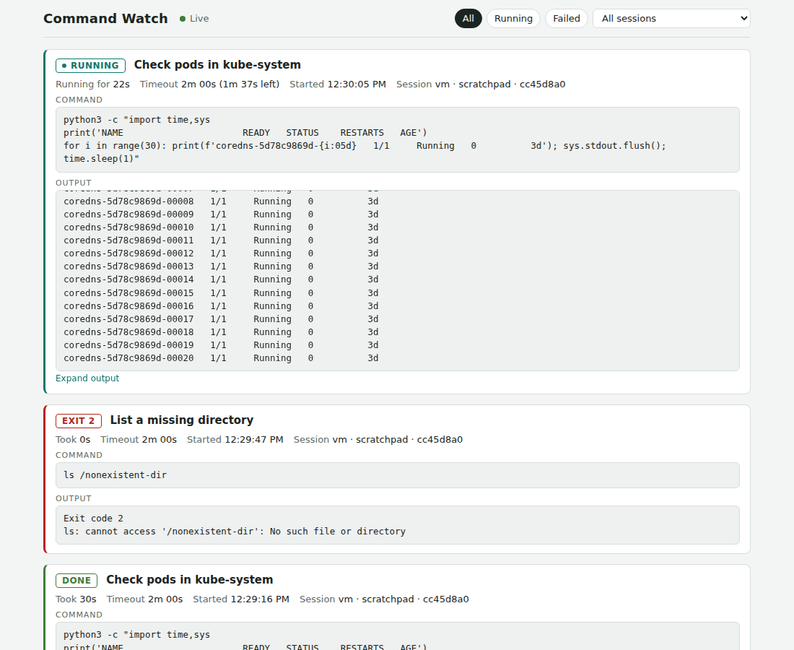

# thread-pulse

Makes running tool calls visible. Built for sessions that do a lot of system
work, where a command that hangs, or quietly takes a wrong path, is easy to
miss.

## What it does

1. **Command Watch.** Every shell command a Claude Code session runs becomes
   a card on a local page: the description, the full command (5 lines visible,
   expandable), timeout and time left, run time, and the output, refreshed
   every 1.5 s and scrolled to the end. Finished cards show the exit code.
   A running card warns when the command prints nothing for 60 s, or when its
   session stops reporting for 45 s. Filter by running, failed, or session.
   All sessions on the machine share one page.
2. **Long-call status line.** A tool call that runs longer than 60 s shows in
   the status line (`⏳ 4m12s Bash: ...`), and `/pulse` lists the running calls.
3. **Claude project threads.** When the session has the project thread tools
   (`mcp__hearthbot__update_status`), a long call adds a
   `✱ Still running (4 min): ...` line to the thread's checklist, and a
   "may be stuck" line after 10 min. The model's own checklist comes back when
   the call ends.

Nothing leaves the machine: the cards are files under
`~/.claude/command-watch/calls/`, and the page listens on 127.0.0.1 only.

## Install

    claude plugin marketplace add max06/claude-mods
    claude plugin install thread-pulse@claude-mods

The first session that starts serves the page at http://127.0.0.1:8765
(`python3` must be on the PATH). When that session ends, the next session that
is running takes over within a minute. `/command-watch` shows the address and
who serves it. In a container or VM, forward port 8765 (VS Code does this from
its Ports view).

For the thread checklist line, allow the tool once so the mod's writes are not
held for approval, in `~/.claude/settings.json`:

    { "permissions": { "allow": ["mcp__hearthbot__update_status"] } }

## Options

Set with `/plugin configure thread-pulse@claude-mods`, or in
`pluginConfigs["thread-pulse@claude-mods"].options` in `~/.claude/settings.json`:

| Option | Default | Meaning |
| --- | --- | --- |
| `thresholdSeconds` | 60 | A call running longer than this shows in the status line and checklist. |
| `warnMinutes` | 10 | A call running longer than this is marked as possibly stuck. |
| `localWatch` | true | Write the Command Watch cards. |
| `serveWatch` | true | Let sessions start the page server. Off: run `command-watch/command-watch-server.py` yourself. |
| `watchPort` | 8765 | Port of the page. |

## How it works

- Claude Code writes each shell command's output to
  `<tmp>/claude-<uid>/<project>/<session>/tasks/<task>.output` while it runs.
  The mod finds that file through `/proc` (the shell that has it open as
  stdout and whose command line holds the command), reads it every 2 s, and
  writes one JSON file per call.
- Output is cleaned (colour codes, `\r` progress bars), masked (private keys,
  age keys, GitHub, AWS and Slack tokens, `Bearer`, `password:` / `token=`
  style values, long mixed-case base64 such as Kubernetes Secret data) and cut
  to the last 16,000 characters. Masking is best effort.
- `command-watch/command-watch-server.py` (Python standard library) serves
  the page and `calls.json`, and deletes cards older than 24 h.

## Claude Desktop (optional)

`command-watch/command-watch-mcp.py` is a small stdio MCP server (Python
standard library) that gives the Claude desktop app the tools `list_calls`
and `clear_finished`. It reads the page's `calls.json`, so it also works when
Claude Code runs in a container or VM that forwards the port. Add it in
Settings, Developer, Edit Config:

    {
      "mcpServers": {
        "command-watch": {
          "command": "python3",
          "args": ["/full/path/to/command-watch-mcp.py"]
        }
      }
    }

On NixOS, run it through nix: `"command": "/run/current-system/sw/bin/nix"`,
`"args": ["--extra-experimental-features", "nix-command flakes", "shell",
"nixpkgs#python3", "--command", "python3", "/full/path/to/command-watch-mcp.py"]`.

A claude.ai artifact that declares the `mcp` capability with server
`host:command-watch` can then show the cards inside the desktop app. Open it
from the artifacts view: other places that show an artifact cannot reach
local servers.

## Limits

- Linux only (`/proc`). The status line and checklist line work everywhere.
- The page shows Bash calls; other tools only appear in the status line.
- Commands moved to the background end their card when Claude Code reports
  the task as finished.
